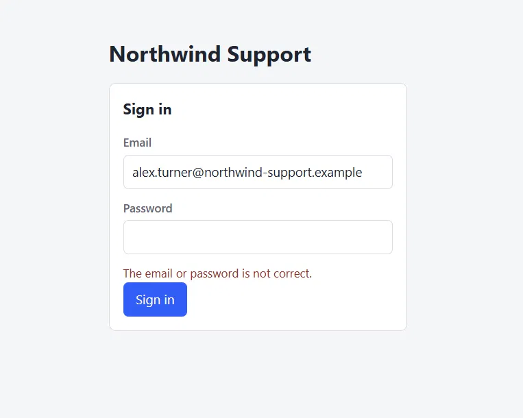
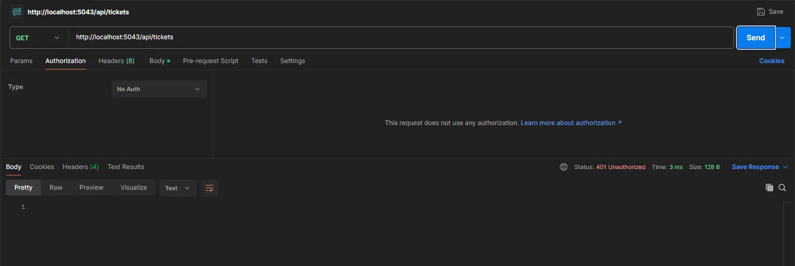
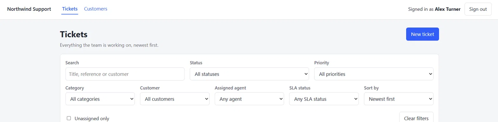
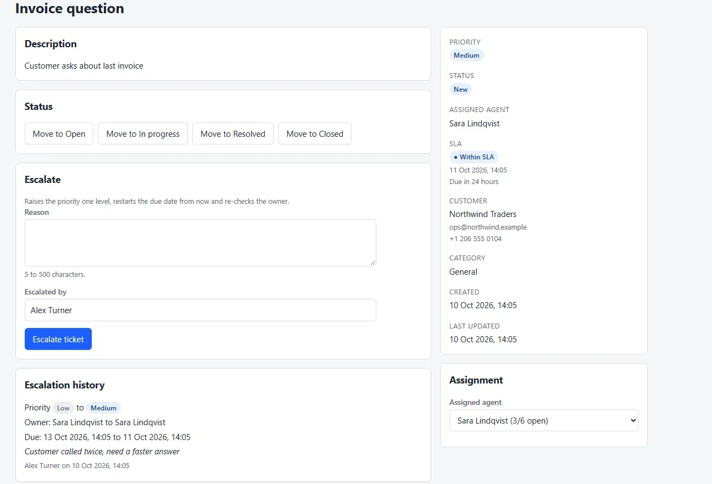

# Task 3: signing in

**In short:** agents sign in with their email and password and get a signed token. Every endpoint
except login and Swagger needs that token, and the person who escalates a ticket now comes from
the token instead of a box on the form.

## Before

Before this task anyone who could reach the URL could read and change everything. The escalation
form also asked the agent to type their own name, so the history showed whatever was typed.

## Decisions

| Decision | What I chose | Why |
| --- | --- | --- |
| Where the password lives | A nullable `PasswordHash` column on `Agent` | Every user is an agent and there are no roles, so a separate `Users` table would only add a join. The hash is never put in a response |
| Hashing | ASP.NET Identity's `PasswordHasher` | A vetted, salted PBKDF2 hash. I didn't write any hashing myself |
| Token lifetime | 60 minutes, set by `Jwt:LifetimeMinutes` | There are no refresh tokens, so a shorter life limits a stolen token. A longer one is a one-line config change |
| Where the browser keeps it | `sessionStorage` | It is cleared when the tab closes and isn't shared between tabs. The trade-off: any script on the page can read it, so an XSS bug would expose it |
| Dev password | One shared fixture for every seeded agent | Each agent still gets their own salted hash, made when the data is seeded. The seeder only runs in Development |
| Signing key | From configuration, never in code | `Jwt__SigningKey` in the environment (see `.env.example`). The app refuses to start without a key of at least 32 bytes |

## How it works

`POST /api/auth/login` takes an email and a password and returns a token, when it expires and the
agent's name. A wrong password, an unknown email, an inactive agent and an agent with no password
all give the same 401 with the same message, so nobody can tell which part was wrong. When there
is no password to check, the supplied one is still hashed, so the timing doesn't give it away.

`GET /api/auth/me` returns the signed-in agent, and checks they are still active.

Closing everything is done in one place: a fallback authorization policy that requires a signed-in
agent for every endpoint, and `[AllowAnonymous]` only on login. A new endpoint is closed by
default. Swagger is served before routing, so it stays open, and it has an Authorize button for
pasting the token.

In the web app, `client.ts` adds the token to every call. Any 401 on a call that sent a token
clears the session, and the route guard then sends the visitor to `/login` and remembers the
page, so signing in brings them back to it.

## Who escalated comes from the token

Before, the form had a text box and the agent typed their own name, so anyone could enter any
name:

Now the request is only the reason. The server takes the name from the token, and the form just
says who it will be recorded as. If a body still contains an `escalatedBy` value, it is ignored.

## How I checked it

- Backend: the login handler (right and wrong password, unknown email, inactive agent, the same
  message for each, no token issued on failure), the password hasher (not the plain text, right
  and wrong passwords, a different hash each time), and the token (claims, expiry, signing key,
  startup checks).
- The same backend tests start the whole application in memory and send real HTTP requests:
  every existing endpoint is 401 without a token, 200 with one, a token signed with another key
  or an expired one is 401, and an escalation records the signed-in agent whatever the body says.
- Web: the route guard, returning to the wanted page, the login form's validation and error
  states, the token being attached, and a 401 clearing the session.
- By hand, on the running app and Postman: the screenshots above.

## The weakest part

The token sits in browser storage, and I can't revoke it. Any script running on the page could
read it from `sessionStorage`, and a signed token stays valid until it expires. The 60 minute
life limits that, and `/me` checks the agent is still active, but other endpoints don't look the
agent up again. A real fix would be an httpOnly cookie with short tokens, refresh tokens and a
revocation list, which this task lists as not wanted.

## Limitations

- No refresh tokens: after 60 minutes the agent signs in again.
- No token revocation: a deactivated agent's token keeps working until it expires, apart from `/me`.
- No lockout or rate limiting, so passwords can be guessed.
- Every seeded agent shares one development password, which is only for local use.
- Not built, because the task says not to: registration, password reset, email verification,
  OAuth/SSO, MFA, roles and HTTPS certificate work.
