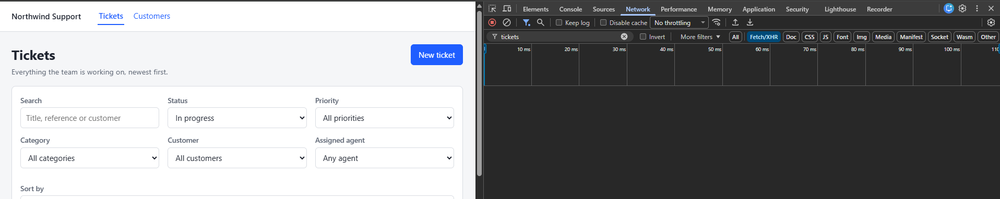
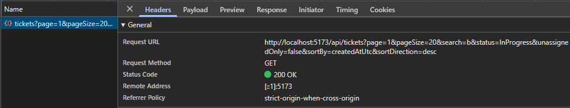
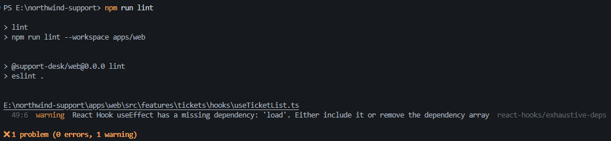
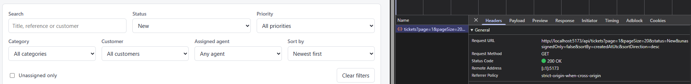

# DEFECT-117: Ticket filters on the list sometimes do not work

**Root cause:** The `useEffect` responsible for loading tickets in `useTicketList` depended only
on `search`, `page` and `pageSize`. Changes to other filters updated the state but did not trigger
a new request. An ESLint suppression also hid the missing dependency warning.

## What was reported

Changing the Status dropdown to *In progress* did not send a request to `GET /api/tickets`.
Typing in the search box then triggered a request containing the previously selected status.
Clearing the search could leave the list appearing stale again.

## Reproducing it

I opened the app on page 1, opened DevTools, went to the Network tab, filtered for `tickets`
(Fetch/XHR) and cleared the log. Then I changed Status to *In progress*.



The dropdown showed *In progress* but no request was sent, so the server was not ignoring the
filter. The request never left the browser.

Then I typed `b` into the search box:



This time a request went out and its URL already contained `status=InProgress`
(`...search=b&status=InProgress&unassignedOnly=false...`). The status had been stored correctly
and was only sent because the search change triggered a fetch.

## Finding the cause

I traced the status value through `TicketFilters.tsx`, `TicketListPage.tsx` and `updateFilters`
in `useTicketList.ts`. Each step updated the state correctly, so the problem was in the logic
that triggered data loading:

```ts
useEffect(() => {
  const handle = window.setTimeout(load, DEBOUNCE_MS);
  return () => window.clearTimeout(handle);
  // eslint-disable-next-line react-hooks/exhaustive-deps -- filters object identity changes every render
}, [filters.search, filters.page, filters.pageSize]);
```

The dependency array lists three of the eleven filter fields. Status, priority, category,
customer, assigned agent, unassigned-only, sort field and sort direction are missing, so changing
one of them did not rerun the effect unless another dependency also changed.

That also explains why the defect was intermittent. `updateFilters` always resets `page` to 1,
and `page` is a dependency. On page 2 or later, changing a filter moved the page back to 1, the
effect ran and the filter appeared to work. On page 1 the page did not change, so nothing ran.

### The suppressed warning

The `eslint-disable` comment hid exactly this problem. With it removed, `npm run lint` reports:



The warning names `load`, not the individual filters. `load` is recreated on every render and
reads the current filters, but the effect kept an old copy because `load` was not in the array.
Adding `load` to the array would have refetched on every render, so the fix had to be driven by
the filters themselves. The comment's justification, that the `filters` object changes identity
every render, was also wrong: `filters` is state and only changes when `setFilters` is called.

## The fix

I reworked `useTicketList` so changes to the applied filters trigger a request immediately,
while the search text is debounced by 300 ms. This prevents a request for every keystroke while
ensuring the search request includes the latest selected filters.

- The hook keeps the filters that requests are made with separately from the text currently in
  the search box.
- Dropdowns, the unassigned-only checkbox and sort update the applied filters straight away.
- Typing updates only the text, which is copied into the applied filters 300 ms after typing stops.

I also removed the lint suppression and moved loading onto the existing `useAsyncData` hook, so
there is no hand-written dependency array left to get wrong. A filter added later, such as the
SLA status in Task 2, needs no extra wiring.

## How I verified it

The regression tests (`useTicketList.test.ts`, "DEFECT-117") assert the arguments of the request
that is sent. Seven tests cover immediate updates when status, priority, category, customer,
assigned agent, unassigned-only and sorting change.

The tests also cover search debouncing (one request after typing settles, carrying the earlier
status), keeping the typed text in the box while a request is pending, and clearing the filters.
With the original hook put back, the seven immediate-update tests fail; with the fix they pass.
The debounce and reset tests pass on both, because the original already behaved correctly there.

I also checked in the browser that changing Status sends a request immediately:



## Limitation

Out-of-order responses are not covered by this change. A slower earlier request could still
finish after a newer one and overwrite its results.

## Lesson

Don't silence `react-hooks/exhaustive-deps` without understanding why it fires. Here it was
pointing at the real bug.
