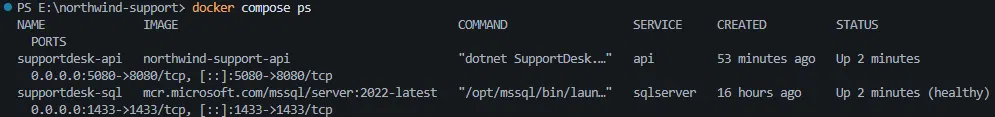
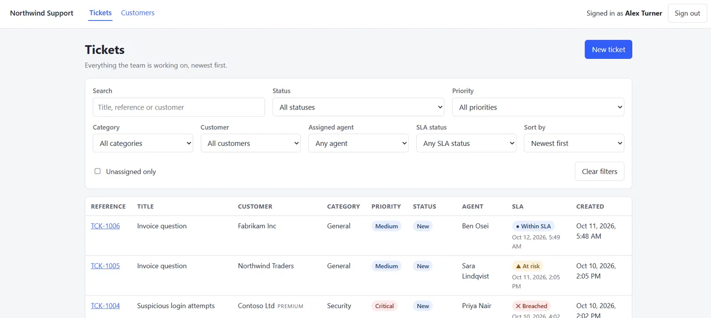
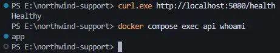

# Task 4: running the API in Docker

**In short:** `docker compose up --build` builds the API image, starts SQL Server, waits until it
is healthy, then starts the API on http://localhost:5080. On an empty database the API migrates
and seeds itself. The image holds no connection string and no key.

## Before

Before this task `docker compose up` only started SQL Server. The API ran on the host with
`npm run api`, so it needed the .NET SDK installed, and there was no way to run the backend the
same way on every machine. The API also had no health endpoint, so nothing could ask it whether
it was working.

## How to run it

```bash
docker compose up --build        # SQL Server on 1433, API on http://localhost:5080
curl http://localhost:5080/health
```

`docker compose ps` then shows SQL Server healthy and the API published on port 5080:



Sign in with the development login in the README, then call `/api/tickets` with the token. To
point the web app at the container instead of `npm run api`:

```bash
VITE_API_PROXY_TARGET=http://localhost:5080 npm run web
```

`apps/web/vite.config.ts` reads that variable for its proxy target. This is the web app signed in
and listing tickets from the container:



## What is in the image

| Part | What I did | Why |
| --- | --- | --- |
| Build | `dotnet/sdk:10.0` restores, builds and publishes | The SDK is only needed to build |
| Run | `dotnet/aspnet:10.0` runs the published output | No compiler or SDK in what ships |
| Restore | `global.json`, `Directory.Build.props`, `Directory.Packages.props` and the four `.csproj` files are copied and restored **before** the source | Package restore is the slow step, and it only changes when a project file does |
| User | `USER $APP_UID`, the `app` user that the base image already has | Not root |
| Port | `ASPNETCORE_URLS=http://+:8080`, plain HTTP. Compose publishes it as `127.0.0.1:5080` | The task says no certificates in the image, and "published on localhost" means this machine only |
| Config | Nothing set in the image | The connection string, `Jwt__SigningKey` and the environment name arrive as environment variables |

`.dockerignore` keeps `bin/`, `obj/`, `node_modules/`, `.git/`, `.env`, the web app, the tests and
the docs out of the build context.

It also keeps `appsettings.Development.json` out. That file holds the local SQL password and a
development signing key, so if it were copied the image would have configuration and a secret baked
in. Without it the image only has `appsettings.json` (the `Sla` rules and the token settings), and
the connection string and signing key must come from the environment.

## Environment variables

| Variable | Where it comes from | Default for local use |
| --- | --- | --- |
| `ConnectionStrings__Default` | Built in `docker-compose.yml` from `MSSQL_SA_PASSWORD`, with the host set to the service name `sqlserver` | Same local SQL password as before |
| `Jwt__SigningKey` | `JWT_SIGNING_KEY` from `.env` | A local fixture, so the stack starts without a `.env` |
| `ASPNETCORE_ENVIRONMENT` | `.env`, otherwise `Development` | `Development` |

The two defaults are throwaway local values, like the SQL password that was already in the compose
file. Anywhere that is not a laptop needs a real random `JWT_SIGNING_KEY`. The app refuses to start
with a key shorter than 32 bytes.

## Decisions

- **Chosen:** the API migrates and seeds itself on an empty volume, using the existing
  Development-only code. **Rejected:** a new setting to do it in other environments, which is more
  change for a demo. The cost is that the container runs as `Development`, so Swagger is on.
  Production would use a separate migration step.
- **Chosen:** local default values in compose for the SQL password and the signing key, so a
  reviewer can start the stack without a `.env`. **Rejected:** requiring them, which would stop a
  reviewer on the first command. They are fixtures, and the doc says to replace them.

## Migrations and seed data

On an empty volume the API applies the migrations and seeds the demo data when it starts. That
code only runs when the environment is `Development`, so compose defaults to it. The cost is that
Swagger is switched on in the container too.

This is a convenience for a demo, not how I would deploy. In a real deployment I would run
migrations as a separate step, such as an EF Core migration bundle run by the release pipeline
before the new version starts. The reasons:

- With several API instances starting together, each one would try to migrate the same database.
- The app's own database user would need rights to change the schema, which it shouldn't have.
- A failed migration should stop the release, not leave half the instances crash-looping.
- Seeding demo data and a shared development password have no place in production.

## `/health`

`GET /health` returns `200 Healthy` when the database can be reached, and `503 Unhealthy` when it
can't. It does a connection check and reads no data.

It is opened with `AllowAnonymous` where it is mapped in `Program.cs`, beside the fallback policy
that closes everything else, so it needs no token. A test covers the unhealthy result itself. I
didn't take the database down and call it over HTTP, so the 503 is ASP.NET's default and not
something I saw.

## How I checked it

- `docker compose up --build`: SQL Server became healthy first, then the API started.
- `GET /health` with no token gave `200 Healthy`. `GET /api/tickets` with no token gave `401`, and
  after signing in it returned the ticket list.
- Empty volume: I started a second copy of the stack (its own project name, its own volume, port
  5081) so my own data wasn't wiped. It came up healthy and returned 40 seeded tickets, and I
  removed it afterwards.
- Restore is cached: I changed one `.cs` file and rebuilt. The `COPY` of the project files and
  `dotnet restore` were `CACHED`; only the `COPY` of the source and `dotnet publish` ran again.
- Non-root: `docker compose exec api whoami` printed `app` (picture below).
- Size, as `docker images` shows it: the API image is 455 MB, the `aspnet:10.0` image it is built
  on is 340 MB, and the SDK image is 1.3 GB.
- Web app: I ran it in a browser against the container, with `VITE_API_PROXY_TARGET` set as above.
  It redirected to the login page, signed in and loaded the ticket list (picture above).

The health check and the non-root user:



## What I would change before production

- Run migrations as a separate step, as above, and stop seeding.
- Run with `ASPNETCORE_ENVIRONMENT=Production`: no Swagger, and no development key file.
- Take the signing key and the database password from a secret store, not from a `.env` file, and
  give the app a database user that can't change the schema.
- Pin the base images by digest and scan the image, so a build is repeatable and checked.
- Put HTTPS and a proper CORS origin in front of it, and add a `HEALTHCHECK` or a platform probe on
  `/health`.

## Limitations

- The `Development` environment is needed for migrate and seed, so the demo container has Swagger
  on.
- The compose file has local default values for the SQL password and the signing key. They are
  fixtures, and they are the first thing to replace.
- The image has no `HEALTHCHECK` of its own. Compose waits for SQL Server's check, and `/health` is
  there for whatever runs the container.
