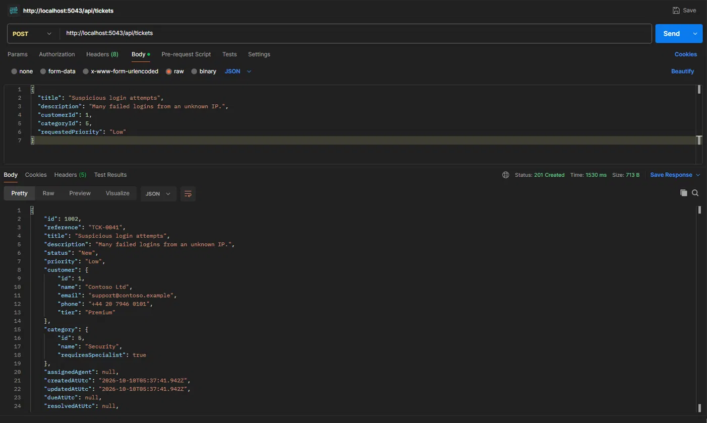
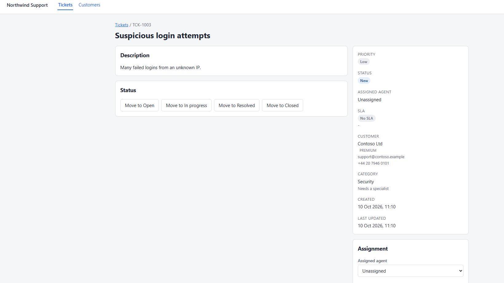
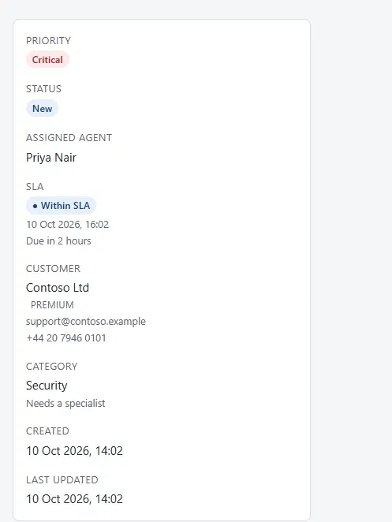
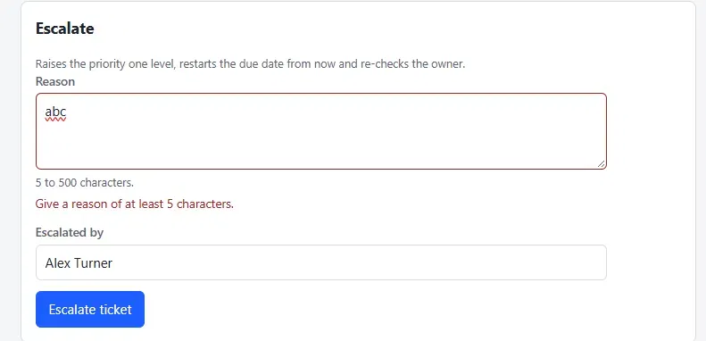
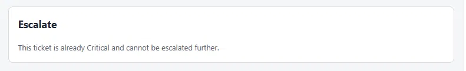

# Task 2: triage and escalation

**In short:** a new ticket now gets its priority, due date and owner from rules instead of by hand,
and the response says why. An agent can escalate a ticket one level with a reason, and every
escalation is kept. SLA status is worked out from the dates and is never stored.

## What it looked like before

First I wanted to see what the app did before I changed anything. In Postman I raised a ticket
for Contoso (a Premium customer) in the Security category, asking for priority Low.

It came back as Low, with no agent and no due date. I did the same in the web app, and the detail
page said Low, Unassigned and "No SLA". These are two different tickets (TCK-0041 and TCK-1003),
which is why the references differ.

So a Security ticket could sit at Low with nobody on it and no deadline.

## The rules as I understood them

| Rule | What I built |
| --- | --- |
| Priority | The requested one, Medium if none. A category flagged `ForcesCriticalPriority` is always Critical |
| Due date | Start plus a window: Critical 4 h, High 8 h, Medium 24 h, Low 72 h. Premium gets half, never under 1 hour |
| Owner | Active agents below their limit. Specialist categories need the specialization. Fewest open tickets wins. If nobody fits, the ticket is unassigned and says why |
| Config | The windows, multiplier, floor and threshold come from the `Sla` section, not from code |
| Escalation | One level up, due date restarted from now, owner kept if still eligible, a history row written. Critical, Resolved and Closed are refused |
| SLA status | Worked out from the due date, the resolution time and "now" |

A few things the spec didn't say, so I decided:

- "25% or less" counts the line itself, so exactly 25% left is At risk.
- The ticket being escalated isn't counted against its own agent's limit. Otherwise an agent
  at 6 of 6 would lose every ticket they already have.
- When agents are equal, the lowest id wins, so the answer never changes between runs.
- If nobody is eligible after an escalation, the ticket becomes unassigned and says why.
- The At-risk window comes from the config (priority and customer tier), not from a stored
  column. The cost is that changing the `Sla` section or a customer's tier also changes the
  status of old tickets.

## Where each rule lives

The point of the task was where the rules go, so I kept them out of the controller and the
handlers.

| Rule | Class |
| --- | --- |
| Windows, multiplier, floor, threshold | `SlaPolicy`, built from the `Sla` section at startup |
| Priority | `PriorityResolver` |
| Owner | `AgentSelector` |
| Escalation | `Ticket.Escalate`, which creates a `TicketEscalation` |
| SLA status | `SlaEvaluator` |
| Putting them together and explaining it | `TicketTriage` |

Creating and escalating both go through `TicketTriage`, so nothing is written twice. The domain
classes don't know about the database or the web layer, and an architecture test checks that.

## Triage on create

After the change I raised the same ticket again: Contoso, Security, requested Low. It came out
Critical, with Priya Nair, due two hours later. Security forces Critical, and a Premium customer
gets half of the 4 hour window. Priya was picked because she is a Security specialist with fewer
open tickets than the other one, who is full.

The picture is the ticket's summary panel. The create response also has a `triage` object with a
reason for the priority, the window and the owner, and the web app shows them in a box after
raising a ticket (I didn't take a picture of that box). If nobody is eligible the response is
still 201, with the ticket unassigned and a reason such as "Left unassigned: …".

## Escalation

`POST /api/tickets/{id}/escalate` takes a reason, and who escalated is the signed-in agent's
token. A reason under 5 or over 500 characters after trimming is a 400. An unknown ticket is a 404. A Critical,
Resolved or Closed ticket is a 409, and the message says which.

The form checks the same limits first, so a bad reason never reaches the API. I tried "abc":

This screenshot was taken before Task 3, so it still shows the old "Escalated by" field.

An accepted escalation updates the ticket on the page and adds a row to the history, which is
the next section. The ticket and the history row are saved together in one save.

Once a ticket is Critical, or if it is Resolved or Closed, the form is replaced by the reason:

## History

To see it work I escalated a Low ticket for Fabrikam Inc with the reason "Customer called twice,
needs a faster answer". It went to Medium and the due date moved from 14 Oct to 12 Oct, which is
24 hours from the escalation: the Medium window for a standard customer like Fabrikam. Ben Osei
kept the ticket, and the history shows what changed, the reason, who did it and when.

This screenshot was taken after Task 3: the form says "Recorded as Alex Turner", and the history
shows Alex Turner because the name came from the signed-in agent's token.

`GET /api/tickets/{id}/escalations` returns the entries newest first, with the agent names
joined in the same query.

## SLA status and the filter

`?slaStatus=` takes `NotApplicable`, `WithinSla`, `AtRisk`, `Breached` or `Met`. It is one more
block in `ApplyFilters`, so the count, sorting and paging stay in SQL. The at-risk span for each
priority and tier is worked out in C#, and SQL only compares dates with those values.

I have no screenshot for the filter. It was checked two ways:

- tests on SQLite for every status and every boundary, including one that builds tickets around
  each boundary and checks the filter agrees with the status shown on each row;
- the real SQL Server, where the five statuses came back as 2, 2, 2, 24 and 12 tickets. That is
  all 42 tickets, and every row had the status that was asked for.

## Database

One new table, `TicketEscalations`, from the `AddTicketEscalations` migration. The agent and due
date columns are nullable, because a ticket can have no owner or no due date. The foreign keys to
the ticket and both agents are `Restrict`, so history can't be deleted by accident, and a test
checks that a ticket with history can't be removed.

The index on `(TicketId, EscalatedAtUtc DESC)` serves "the history of one ticket, newest first"
and is also the index on the ticket foreign key. EF added two more, on `FromAgentId` and
`ToAgentId`. Nothing queries them, but they make the foreign key check cheap when an agent
changes.

## How I checked it

- Backend: 163 unit tests and 4 architecture tests. They cover the windows and the floor, forced
  Critical, agent selection, escalation, and the SLA boundaries with a fixed clock.
- Web: 46 tests. They cover a short reason blocking submission without calling the API, a 409
  being shown with the ticket unchanged, and every SLA state rendering differently.
- The 400, 404 and 409 responses were checked against a running API. I don't have a picture of
  the 409; the handler tests cover its message.

## Limitations

- Open-ticket counts are read and then used, so two tickets raised at the same moment could both
  go to an agent who has room for only one.
- Changing the `Sla` section or a customer's tier changes the status of tickets that already
  exist.
