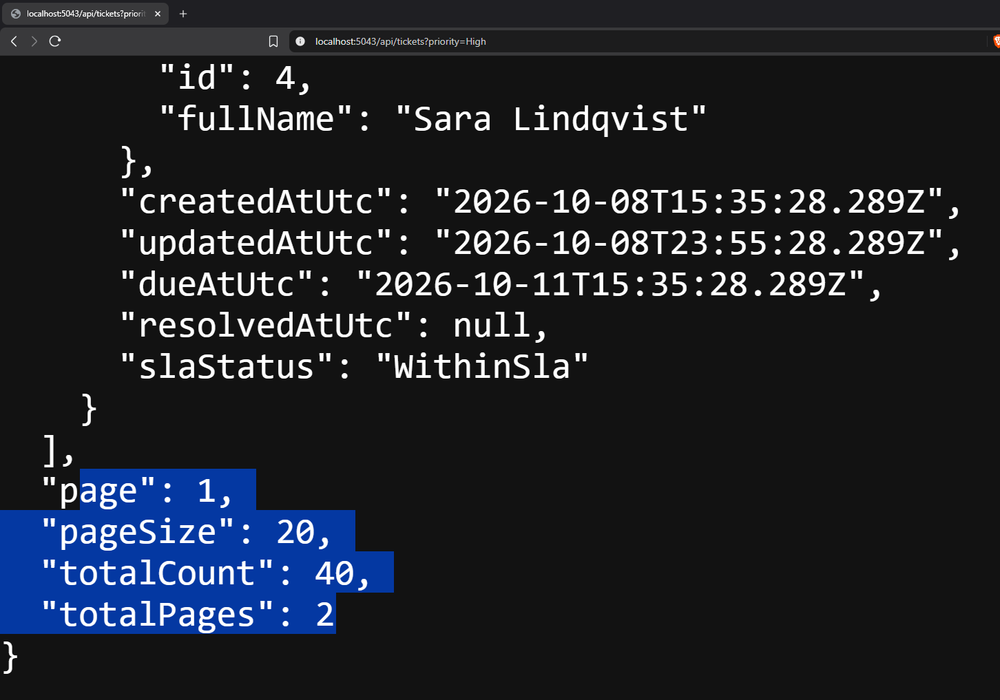
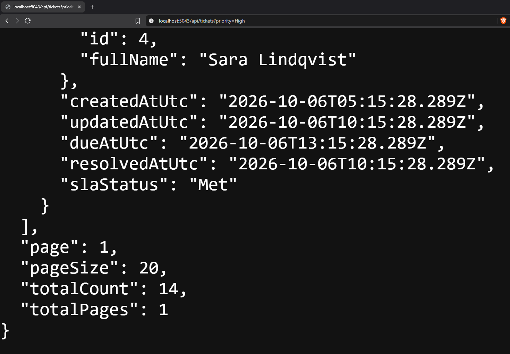

# Task 1.2: server-side filtering

**Summary:** the API read the filter values but never used them, so every request returned all
40 tickets. The filters are now applied in the database, before counting and paging, so
`totalCount` and the pager describe the filtered set.

## Before

The web app was already sending the filters, but the API ignored them. Requesting only High
priority tickets still returned everything:



The URL is `/api/tickets?priority=High` and the response says `"totalCount": 40` and
`"totalPages": 2`, which is every ticket.

## What I changed

The change is in `TicketQueries.GetPagedAsync` (Infrastructure). It used to count and page the
whole list. Now it narrows the list first:

```csharp
var tickets = ApplyFilters(TicketsWithLabels(), query);
var totalCount = await tickets.CountAsync(ct);
```

`ApplyFilters` adds one `Where` per filter that was supplied:

| Parameter | Rule |
| --- | --- |
| `status`, `priority`, `categoryId`, `customerId`, `assignedAgentId` | Exact match |
| `unassignedOnly=true` | Only tickets with no assigned agent |
| `search` | Trimmed, ignored if blank; matches title, reference or customer name |

Each filter is its own `Where`, so they all have to match. EF Core turns the whole query into
SQL, so nothing is filtered in C#.

## After



The same request now returns `"totalCount": 14` and `"totalPages": 1`. The other 26 tickets were
filtered out by the database before counting.

## How I checked it

The tests in `TicketQueriesFilterTests` run the query against an in-memory SQLite database, so
the filters really become SQL. They cover:

- exact match for status, priority and category;
- a combination of customer, category and priority, which must all match;
- search by customer name, by title and by reference;
- a trimmed search and a blank search that is ignored;
- unassigned-only and assigned-agent;
- count and pages for a filtered set (5 matches, page size 2, page 3 gives 1 item and 3 pages);
- `%` and `_` in the search text treated as plain characters, and a page past the end that is
  empty while the count is still right.

With the original query put back, 12 of the 14 tests fail. The two that still pass ("no filters
returns every ticket" and "a page past the end is empty") describe behaviour that already worked.

## Adding the next filter

Add the field to `TicketQuery` and one more `if` block in `ApplyFilters`. The count, sort and
paging need no changes. The SLA status filter in Task 2 follows the same pattern.

## Limitations

- `Contains` is case-insensitive on SQL Server because of its default collation, but SQLite
  (used in the tests) is case-sensitive, so the tests use exact case.
- Search uses `LIKE '%text%'`, which can't use an index. That's fine for 40 tickets, but a big
  table would need full-text search.
